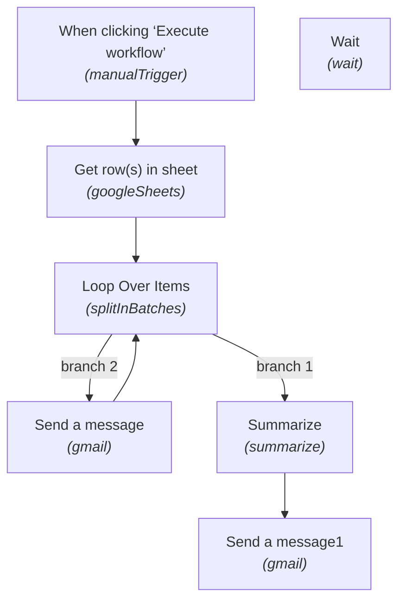

# ⚡ Batch Processing & Loop Throttling

[](https://n8n.io)
[](#)
[](#)
[](#)

> **Workflow Sequence #05** in the [Maheen Azhar n8n Workflow Collection](https://github.com/maheenazhar/n8n-workflows-collection).


> 📊 **In-Depth Technical Report:** For detailed node configurations, runtime mechanics, security audits, and failure mode analysis, read the **[Comprehensive Technical & Operational Report](REPORT.md)**.

---

## 📖 Overview

Demonstrates safe batch looping over dataset records using SplitInBatches, rate-limiting delays via Wait node to respect API quotas, summarizing batch results, and dispatching a final batch execution report.

### 🎯 Key Use Case
Bulk email campaigns, mass record updates, and API-quota-safe data synchronizations.

---

## 🏗️ Architecture & Flow



---

## 🧩 Nodes in this Workflow

| # | Node Name | Type | Version |
|---|-----------|------|---------|
| 1 | **When clicking ‘Execute workflow’** | `n8n-nodes-base.manualTrigger` | v1 |
| 2 | **Get row(s) in sheet** | `n8n-nodes-base.googleSheets` | v4.7 |
| 3 | **Loop Over Items** | `n8n-nodes-base.splitInBatches` | v3 |
| 4 | **Send a message** | `n8n-nodes-base.gmail` | v2.2 |
| 5 | **Wait** | `n8n-nodes-base.wait` | v1.1 |
| 6 | **Summarize** | `n8n-nodes-base.summarize` | v1.1 |
| 7 | **Send a message1** | `n8n-nodes-base.gmail` | v2.2 |

---

## 🔑 Prerequisites & Credentials

Before running this workflow, ensure you have the following configured in your n8n environment:

- [ ] **Google Sheets credential**
- [ ] **Gmail credential**
- [ ] **Spreadsheet with bulk contact/task records**

> [!NOTE]
> All credentials are decoupled from this export file for security. When importing into your n8n workspace, re-assign your local credentials in the respective node configuration panels.

---

## 🚀 Setup & Installation

1. **Clone or Download:**
   ```bash
   git clone https://github.com/maheenazhar/n8n-05-loop-over-data.git
   cd n8n-05-loop-over-data
   ```
2. **Import into n8n:**
   - Open your n8n canvas.
   - Click the top-right menu `...` -> **Import from File**.
   - Select `workflow.json` from this repository.
   - *(Alternative)*: Open `workflow.json`, copy the entire JSON contents, and paste directly (`Ctrl+V`) onto the n8n canvas.
3. **Configure Credentials:**
   - Open each integration node marked with a red credential prompt.
   - Select or configure your accounts (e.g., Google OAuth, Groq API, Supabase, SMTP).
4. **Activate / Test:**
   - Click **Test step** or **Execute Workflow** to verify end-to-end functionality.
   - Toggle the workflow to **Active** for live production use.

---

## 📄 File Structure

```
05-loop-over-data/
├── workflow.json   # Full exportable n8n workflow definition
├── README.md       # Comprehensive documentation and architecture
└── .gitignore      # Standard Git exclusions
```

---

## 👤 Author & Repository

- **Author:** [Maheen Azhar](https://github.com/maheenazhar)
- **Workflow ID:** `kZqRN08xDL3s3OI3`
- **Created Date:** `2026-10-08 04:12:59.868`
- **Last Modified:** `2026-10-08 04:26:37.505`
- **Repository:** [`https://github.com/maheenazhar/n8n-05-loop-over-data`](https://github.com/maheenazhar/n8n-05-loop-over-data)

---

*Part of the [n8n Workflows Collection](https://github.com/maheenazhar/n8n-workflows-collection) by Maheen Azhar.*
